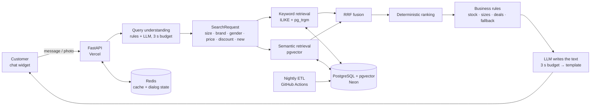
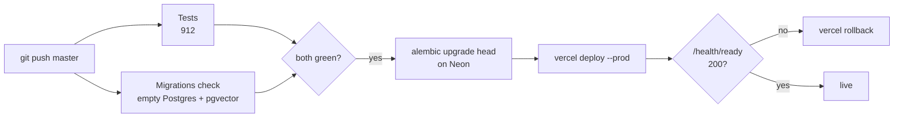

# TopSport AI Product Search Assistant

A production-oriented **conversational product search** for [TopSport](https://topsport.ge) — a Georgian multi-brand sports retailer (~9,500 product pages, ~40,000 size variants).

Customers write the way they talk — in Georgian, English or transliterated Georgian (`bichistvis sportuli 33 zoma`) — or simply send a photo, and get the right products in stock, in their size and budget.

**Live demo:** [chat widget](https://ai-commerce-search-engine-ys44.vercel.app) · [API docs (Swagger)](https://ai-commerce-search-engine.vercel.app/docs)

> **Core principle — Search decides → Business rules decide → LLM speaks.**
> The LLM never picks products or prices. A deterministic search engine finds and ranks them, business rules apply the store's logic, and the LLM only helps to understand the message and to phrase the answer. If the LLM is slow or unavailable, the customer still gets correct products — with a template answer.

---

## Highlights

| | |
|---|---|
| 🔎 **Hybrid search** | Structured filters + keyword search (PostgreSQL `ILIKE` + `pg_trgm`) + semantic search (pgvector, Gemini embeddings), fused with **Reciprocal Rank Fusion** |
| 🧠 **Query understanding** | Rules first (size, brand, gender, budget, discount, new arrivals), LLM only for free-form phrases — with a **3-second budget** and fallback to rules |
| 💬 **Dialog state** | A per-conversation "condition card" (size, gender, budget, type…) in Redis: *"42" → "+ up to 300 ₾" → "women's"* refines the same search |
| 📷 **Photo search** | Image embeddings for the whole catalog + vision model; honest verdicts: *exact model / similar / not found / not a product* |
| ⚡ **Performance** | Versioned Redis cache, one DB commit per message, background analytics, parallel LLM calls |
| 📏 **Regression search exam** | 52 cases (`eval_search.py`): **strict 92% → 100%**, **hit@5 96% → 100%** — tuned on this set, see [limits](#how-to-read-these-numbers) |
| 🚀 **Production pipeline** | CI → migrations → deploy → health check → automatic rollback; nightly catalog ETL; Docker image |
| ✅ **912 tests** | Unit + integration, incl. parametrized cases; the whole suite runs in ~9 s (`pytest tests -q`, no secrets needed) |

---

## Architecture



**Message pipeline**

1. **Understanding** — deterministic parsers extract size, brand, gender, budget, discount and "new collection"; the LLM (Gemini Flash-Lite) is called only when rules are not enough, in parallel with the query embedding.
2. **Retrieval** — SQL filters narrow the catalog; keyword and semantic candidates are merged with RRF (`k = 60`).
3. **Ranking** — deterministic scoring (exact model word beats a substring: *Samba* above *Sambae*), size availability, deals.
4. **Business rules** — stock, size scarcity, alternatives, "other brand", honest "nothing found".
5. **Answer** — the LLM phrases a short reply around the already chosen products; on timeout a template is used.

---

## Tech stack

| Layer | Technology |
|---|---|
| Backend | Python 3.13, FastAPI, Pydantic, SQLAlchemy 2 |
| Database | PostgreSQL (Neon) + `pgvector` (HNSW) + `pg_trgm`, Alembic migrations |
| Cache / state | Redis (Upstash) — cache-aside with catalog versioning |
| AI | Google Gemini: Flash-Lite (understanding, text, vision), Gemini embeddings (text and images) |
| Frontend | React + TypeScript + Vite chat widget |
| Data pipeline | Scraper (sitemap, 8 workers, retries, checkpoints), Livewire "new collection" collector, embedding loaders |
| Infrastructure | Vercel (API + widget), GitHub Actions (CI/CD + nightly ETL), Doppler (secrets), Docker |
| Observability | `/health`, `/health/ready` (DB + Redis), `/metrics` (Prometheus), per-request `meta.timings` and `meta.sql` |
| Testing | pytest — 912 tests, CI also applies migrations to an empty Postgres |

---

## Results in numbers

**Search quality** — regression exam of 52 queries (`python eval_search.py`): 33 hand-written cases, 18 phrasings taken from search logs, 1 new-arrivals case.

| Metric | Before | After |
|---|---|---|
| Strict (all top-5 results match the request) | 48/52 (92%) | **52/52 (100%)** |
| hit@5 (at least one correct result in top-5) | 50/52 (96%) | **52/52 (100%)** |

#### How to read these numbers

- This set was used **both to find problems and to verify fixes**, so 100% means *"no regressions on known cases"*, not an unbiased accuracy estimate. There is no hold-out set yet.
- Fixes were made as **general rules and new data**, not per-query patches — e.g. Georgian gender word forms → kids, sport type from catalog data, discount words → filter; the last failing case was solved by a new feature (the store's *new collection* flag).
- "Strict" checks that the top-5 respect the request's **constraints** (size, price, type, discount, new) — not the fine ordering of results.
- The search-log phrasings were collected during development, mostly from test sessions, not from real customers.
- **Next step:** a hold-out set of real customer queries, evaluated once without tuning.

**Speed** — optimisation of one chat message (measured locally against the cloud DB):

| | Before | After |
|---|---|---|
| Search stage | 4.7 s | 2.0 s |
| DB queries per message | 16 | 10 |
| Commits per message | 3 | 1 (Unit of Work) |
| Analytics write in the response path | 0.4–0.8 s | 0 ms (background) |

**Load test on production** (`load_test.py`, client in Georgia → server in Ohio, includes network):

| Concurrent clients | LLM | p50 | p95 | Errors | Responses/s |
|---|---|---|---|---|---|
| 10 | on | 1.87 s | 4.17 s | 0 | 2.4 |
| 25 | off | 0.63 s | 2.42 s | 0 | 10.2 |
| 50 | off | 0.84 s | 1.01 s | 0 | 18.5 |
| **100** | off | **1.14 s** | 2.74 s | **0** | **33.9** |

The application itself is not the bottleneck; the free Gemini tier is (≈10–15 requests/min). When it is saturated, the budget + template fallback still returns correct products in 3–5 s with zero errors.

#### Self-hosting capacity (estimate, not measured)

Vercel added server instances automatically. On a single self-hosted server the capacity depends on how the app is run:

- **Distance to the database matters more than CPU.** One message makes ~10 DB round trips. The same code on a laptop in Georgia with the database in the US gave **3.4 responses/s**; on Vercel next to the database — **34 responses/s**. A self-hosted server must run in the same region as the database.
- **One `uvicorn` process uses one CPU core** (the Docker image runs one process). Estimated, next to the DB, LLM off: ~10–25 responses/s on 1 core; ~20–50 on 2 cores with `--workers 2`; scale further with more instances behind a load balancer.
- **Each process opens up to 15 DB connections** (pool 5 + overflow 10) — keep `workers × 15` within the database connection limit.
- **For this store it is enough with a large margin:** 100 people chatting at once (one message every 20–30 s) is ~3–5 messages/s.
- To verify: run the container with limits (`docker run --cpus=1 --memory=512m …`) on a server next to the database and repeat `load_test.py`.

---

## Production pipeline



- **CI/CD** (`.github/workflows/ci.yml`): red tests → no deploy; failed health check → automatic rollback to the previous version. Verified with a deliberate "fire drill".
- **Nightly ETL** (`.github/workflows/etl-nightly.yml`, 05:41 Tbilisi, after the store's own nightly update): scraper → new-collection flags → text embeddings → image embeddings. Each step bumps the catalog version, so search caches refresh without flushing conversations.
- **Safety net**: if the scraper sees less than 50% of the active catalog, it refuses to deactivate products. This guard once prevented ~37,000 products from being switched off when the store changed its page layout.
- **Secrets**: stored only in Doppler and synced to Vercel / GitHub Environments; never in the repo or the Docker image.

---

## Running locally

**Requirements:** Python 3.13, PostgreSQL with `pgvector` (or none — see below), optionally Redis.

```bash
git clone https://github.com/Nanuka-1/ai-commerce-search-engine.git
cd ai-commerce-search-engine
python -m venv .venv && source .venv/bin/activate   # Windows: .venv\Scripts\activate
pip install -r requirements.txt
cp .env.example .env                                # fill in your values
alembic upgrade head
uvicorn app.main:app --reload
```

Open http://localhost:8000/docs.

Without `DATABASE_URL` the app falls back to a local SQLite database and an in-memory cache — enough to explore the API.

**With Docker**

```bash
docker build -t topsport-search .
docker run --rm -p 8000:8000 --env-file .env topsport-search
```

The image is based on `python:3.13-slim`, runs as a non-root user, has a built-in health check and contains no secrets (≈ 83 MB compressed).

**Tests and the search exam**

```bash
pytest tests -q          # 912 tests, no secrets required
python eval_search.py    # 52-case search quality exam (needs the database)
```

### Environment variables

| Variable | Purpose |
|---|---|
| `DATABASE_URL` | PostgreSQL connection string (pooled for the app) |
| `REDIS_URL` | Redis connection string |
| `CACHE_BACKEND` | `redis` or `memory` |
| `GEMINI_API_KEY` | Google Gemini API key |
| `LLM_ENABLED` | Turn LLM understanding / text on or off |
| `LLM_MODELS` | Ordered list of models (fallback chain) |
| `LLM_TIMEOUT_SECONDS` | Upper limit for an LLM call |
| `SEMANTIC_SEARCH_ENABLED` | Turn semantic retrieval on or off |

---

## Project structure

```
app/
  api/            # FastAPI routers: chat, products, analytics, promo
  services/       # query understanding, search, ranking, rules, LLM, photo search, cache
  db/             # SQLAlchemy models and session
  config/         # store configuration (e.g. promo ticker)
  static/         # demo page
alembic/          # database migrations
ingestion/        # scraper, new-collection collector, embedding loaders
frontend/         # React + Vite chat widget (deployed separately)
tests/            # unit and integration tests
eval_search.py    # search quality exam
load_test.py      # load test
.github/workflows # CI/CD and nightly ETL
Dockerfile        # container image
```

---

## Key engineering decisions

| Decision | Why |
|---|---|
| **LLM never chooses products** | LLMs invent prices and models, are slow and non-deterministic. Search and rules are testable and explainable. |
| **Hybrid search instead of vectors only** | Vectors confuse *Samba / Sambae*, sizes *42 / 43*, article numbers. Keywords alone miss *"something warm for winter"*. RRF combines both. |
| **PostgreSQL instead of Elasticsearch** | ~10k products: Postgres with `pg_trgm` + `pgvector` is enough, one less service to run. |
| **Time budgets + templates** | The free LLM tier has 1–12 s latency spikes. Understanding waits 3 s, the answer text 3 s; after that the deterministic path answers. |
| **Catalog-versioned cache** | Search results live 24 h; ETL bumps `catalog:version` instead of flushing Redis, so customer conversations survive updates. |
| **Unit of Work + background analytics** | One commit per message; analytics written after the response — trade-off: a lost event is better than a slower answer. |
| **Server next to the database** | One message makes ~10 DB round trips; the server runs in Ohio next to Neon, only one round trip crosses the ocean. |
| **Frontend separate from backend** | The widget is static files served from a CDN; the API is deployed and scaled independently. |
| **Migrations as a separate CD step** | Schema is changed once by Alembic before deploy, never at application start-up. |

---

## Limitations and next steps

- **LLM quota** — the free Gemini tier is the main bottleneck; a paid key removes it without code changes.
- **Hosting** — Vercel Hobby is for non-commercial use; a commercial launch needs Vercel Pro or the Docker image on a server next to the database.
- **Embeddable widget** — a single `widget.js` (Shadow DOM, CORS) to drop the chat into the store's website.
- **Streaming answers** — async LLM call with token streaming to show the text as it is generated.
- **Unbiased search evaluation** — quality was tuned on its own 52-case set; a hold-out set of real customer queries is needed for an honest accuracy number.
- **Photo search thresholds** — calibrate *exact / similar* on a larger labelled photo set.
- **Test design** — keep moving tests from mocks to behaviour: pure functions, realistic fakes, multi-message "seam" scenarios (stale mock-based integration tests once kept CI red for a week).
- **Container polish** — split production and development dependencies; build the image in CI.

---

## Author

**Nana Apriamova** — backend / AI search engineering.

- LinkedIn: [nanuka-apriamova](https://www.linkedin.com/in/nanuka-apriamova/)
- Email: n.apriamova@gmail.com